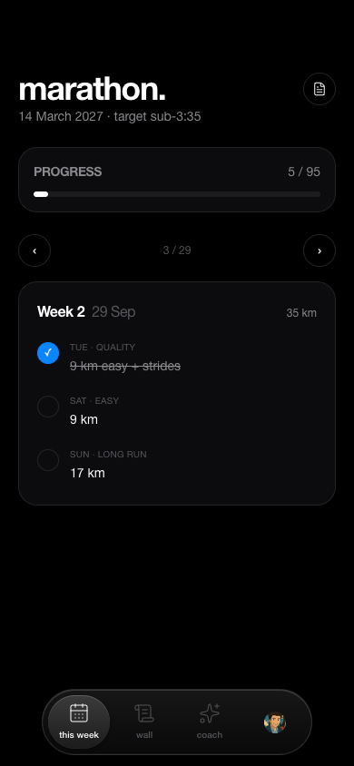
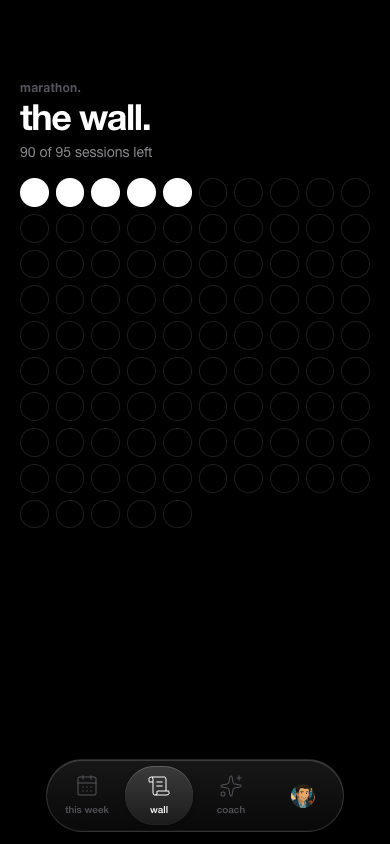
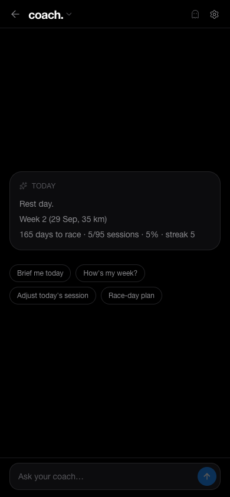
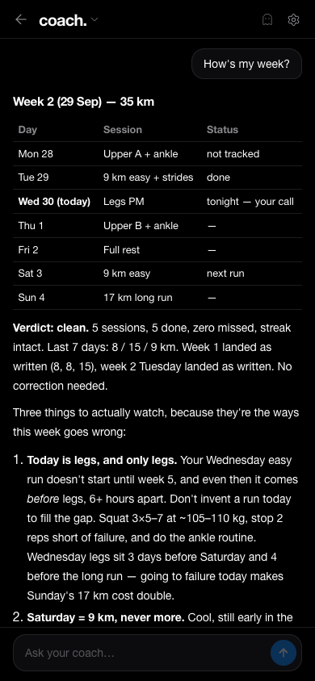

<h1 align="center">marathon.</h1>

A single-user marathon training tracker with an AI coach.

  
  
  
  
  
  
  
  

## About

marathon. is a personal progressive web app for a marathon plan that runs to 14 March 2027. It shows this week's sessions,
a wall of every session in the plan, and an AI coach that knows the plan and what has been done.
It shares its visual language with my other project, [hundred.](https://github.com/polcabezas/hundred-showcase)

> **Case study.** The live app is private and single-user, and the source code is private too.
> This repository is the public write-up: screenshots, features, stack and the engineering decisions behind it.

  
  
  

  
  &nbsp;&nbsp;
  

## Features

- **This week:** the sessions for the current week (quality, easy and long run), with a progress bar across the whole plan.
  Tick a session off and it is recorded.
- **The wall:** one dot per session in the plan. It fills up as the plan gets done, so the remaining work is always visible.
- **Coach:** a multi-conversation AI coach with memory. It is blunt, gives no flattery, and knows the full plan, the gym
  program, paces, race strategy and what has been checked off.
- **Training reminders:** web push, scheduled server-side.
- **Installable:** works as a PWA on iOS.

## Stack

| Layer | Choice |
| --- | --- |
| App | Next.js (App Router), TypeScript, Tailwind, shadcn/ui |
| Data and auth | Supabase: Postgres, Google sign-in, Row Level Security |
| Push | Web Push, sent from a Supabase Edge Function on a `pg_cron` schedule |
| AI | Vercel AI SDK `useChat`, streaming, provider-configurable with a fallback |
| Tests | Vitest, plus typecheck and lint gates |
| Hosting | Vercel |

## Engineering decisions

### The coach is read-only over training data

Every message rebuilds the full plan and the live check status into the system prompt, so the coach can never work from
stale state. Its only writes are its own conversations and memories. It cannot tick sessions off, change the plan or
touch anything else.

### Provider-agnostic AI layer

The model and provider are user preferences, with a fallback provider. Keys stay server-side and never reach the client.

### Locked to one account

Row Level Security protects the data, and the coach is further restricted to a single allowed email, so a stray
sign-in gets nothing.

### A hand-rolled chat UI instead of a chat library

I started on `assistant-ui`, then rebuilt the chat as minimal React on `useChat` plus `react-markdown`. That gave full
control over keyboard handling (only the composer lifts with the keyboard on iOS), streaming and scroll behaviour.
Thread persistence is handled by the client through plain API routes, upserting by message id so retries are safe.

### Spec first

The coach was designed in a written spec before any code: goals, resolved decisions, memory model and phasing.
Strava sync is deliberately post-v1 and slots into a stable context section, so nothing changes when it lands.

### No secrets in git

All keys live in environment variables and Supabase secrets, and none are committed.

## Status

In daily use during training. Source available to discuss in an interview.

---

© 2026 Pol Cabezas Agustí. All rights reserved. Screenshots and text shared for portfolio purposes.
